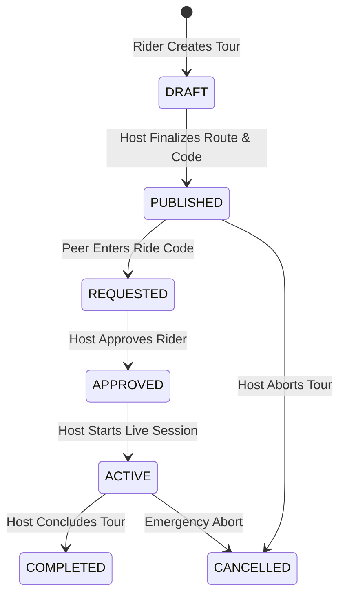

# RIDEX V3 — REALTIME GROUP RIDING & GEODESIC TELEMETRY

**Document Identifier:** `RIDEX-ENG-DOC-006`  
**Version:** `3.0.0-PROD`  
**Date:** September 2026  
**Status:** AUTHORITATIVE SPECIFICATION  
**Author:** RIDEX Realtime Systems & Geospatial Engineering Team

---

## 1. System Objective

The real-time group riding engine provides continuous, low-latency spatial synchronization of all squad participants navigating a shared motorcycle tour. Every rider on Android, iOS, or Web sees peer rider beacons moving live on their cockpit map, receives immediate notifications if a rider is separated from the squad, and maintains situational awareness under intermittent cellular connectivity.

```
                             ┌─────────────────────────────────┐
                             │   ORGANIZER (ROAD CAPTAIN)      │
                             │  • Starts Live Session          │
                             │  • Broadcasts GPS Coordinates   │
                             └────────────────┬────────────────┘
                                              │
                     Realtime Channel         │ Realtime Channel
                     `ride:{rideId}`          ▼ `ride:{rideId}`
             ┌────────────────────────────────┴──────────────────────────────┐
             │                                                               │
             ▼                                                               ▼
┌───────────────────────────────┐                             ┌───────────────────────────────┐
│       PARTICIPANT A           │                             │       PARTICIPANT B           │
│  • Subscribes to Channel      │                             │  • Subscribes to Channel      │
│  • Receives GPS Beacons       │◄────── Geo Clustering ─────►│  • Receives GPS Beacons       │
│  • Computes Separation        │        & Radar HUD          │  • Computes Separation        │
└───────────────────────────────┘                             └───────────────────────────────┘
```

---

## 2. Authoritative Ride Lifecycle State Machine



1. **DRAFT:** Route planning in progress; not visible to public search.
2. **PUBLISHED:** Unique Ride Code generated (e.g. `RIDEX-7X92K`); discoverable by riders.
3. **REQUESTED:** Rider has submitted join request; awaiting organizer approval.
4. **APPROVED:** Rider is an authorized squad member; can enter ride lobby.
5. **ACTIVE:** Live tracking initiated; GPS publishing active, radar operational.
6. **COMPLETED:** Live session terminated; post-ride telemetry and summary generated.
7. **CANCELLED:** Tour aborted by host; participants notified.

---

## 3. Geodesic Separation Detection & Hysteresis

### A. Mathematical Formula
Separation distance between two points $\phi_1, \lambda_1$ and $\phi_2, \lambda_2$ is calculated using the Great-Circle Haversine formula:

$$\Delta\sigma = 2 \arcsin \sqrt{\sin^2\left(\frac{\Delta\phi}{2}\right) + \cos\phi_1 \cos\phi_2 \sin^2\left(\frac{\Delta\lambda}{2}\right)}$$
$$d = R \cdot \Delta\sigma \quad \text{where } R = 6,371,000\text{ meters}$$

### B. Configurable Engineering Thresholds
| Parameter | Threshold Value | Description |
|:---|:---|:---|
| **Warning Separation Distance** | $500\text{ meters}$ | Triggers yellow warning: Squad is spreading out. |
| **Critical Separation Distance** | $1,000\text{ meters}$ | Triggers red warning: "Rider Left Behind". |
| **Warning Recovery Distance** | $400\text{ meters}$ | Hysteresis: Rider must return within $400\text{m}$ to clear warning. |
| **Critical Recovery Distance** | $800\text{ meters}$ | Hysteresis: Rider must return within $800\text{m}$ to clear critical state. |
| **Stale Location Threshold** | $30\text{ seconds}$ | Location has not updated in $>30\text{s}$; marked as `LOCATION_STALE`. |
| **Lost Location Threshold** | $90\text{ seconds}$ | No beacon for $>90\text{s}$; marked as `LOCATION_LOST` / `OFFLINE`. |
| **Alert Cooldown Period** | $15\text{ seconds}$ | Prevents audio/visual alert spam during borderline riding. |

### C. State Classifications per Participant
Every rider is classified into one of 8 deterministic states:
1. `CONNECTED`: Connected to realtime channel, awaiting fresh coordinates.
2. `TRACKING`: Fresh GPS coordinates received ($<30\text{s}$).
3. `NEAR_GROUP`: Within $500\text{m}$ of group cluster reference.
4. `SEPARATED`: Distance $>1,000\text{m}$ from group reference.
5. `LOCATION_STALE`: Last beacon timestamp between $30\text{s}$ and $90\text{s}$.
6. `LOCATION_LOST`: No beacon received for $>90\text{s}$.
7. `OFFLINE`: Disconnected from network or channel.
8. `RIDE_ENDED`: Live tracking closed.

---

## 4. Location Event Payload & Ordering Contract

Every location broadcast over the realtime channel conforms to the strict contract:

```typescript
export interface LiveLocationPacket {
  rideId: string;
  userId: string;
  latitude: number;
  longitude: number;
  heading: number | null;     // 0 - 360 degrees
  speed: number | null;       // km/h
  accuracy: number | null;    // horizontal accuracy in meters
  timestamp: number;          // Unix epoch milliseconds (UTC)
  sequence: number;           // Monotonically increasing sequence ID
  batteryPercent?: number;    // Device battery status
}
```

### Event Ingestion Guard Rules
1. **Timestamp Monotonicity:** Any incoming packet with `timestamp <= lastAcceptedTimestamp[userId]` is immediately discarded to prevent out-of-order replay bugs.
2. **Coordinate Sanity Check:** Latitude must be in $[-90, 90]$, Longitude in $[-180, 180]$, non-zero $(0,0)$ check, and accuracy $<100\text{m}$.
3. **Identity Verification:** Broadcasts must originate from an approved participant of the ride.

---

## 5. Map Radar Experience & Rider Bubbles

The map radar cockpit renders:
- **Host / Road Captain:** Marked with Amber Gold halo and crown badge.
- **Peer Riders:** Circular avatars with initials fallback, colored live status ring, and heading orientation arrow.
- **Rider Detail Card (on tap):** Displays rider name, bike model, distance from me, speed, last beacon time, and separation status.
- **Camera Modes:**
  - `Follow Mode`: Auto-centers on current rider during movement.
  - `Squad Fit Mode`: Fits all active squad members within the viewport bounding box.
  - `Manual Pan Mode`: Allows free navigation without snapping back until recentered.
